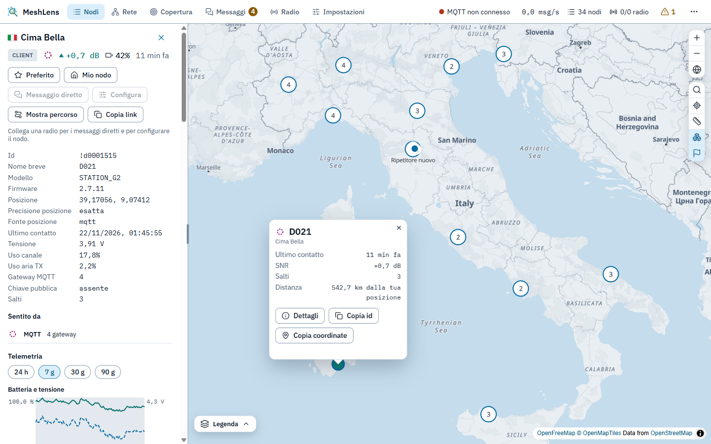
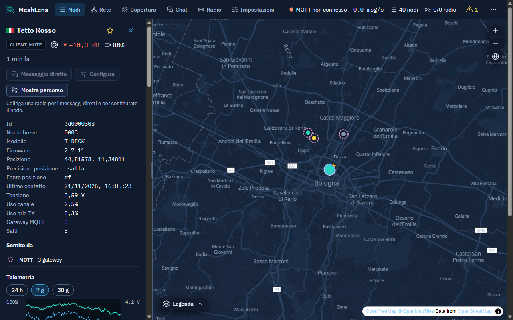
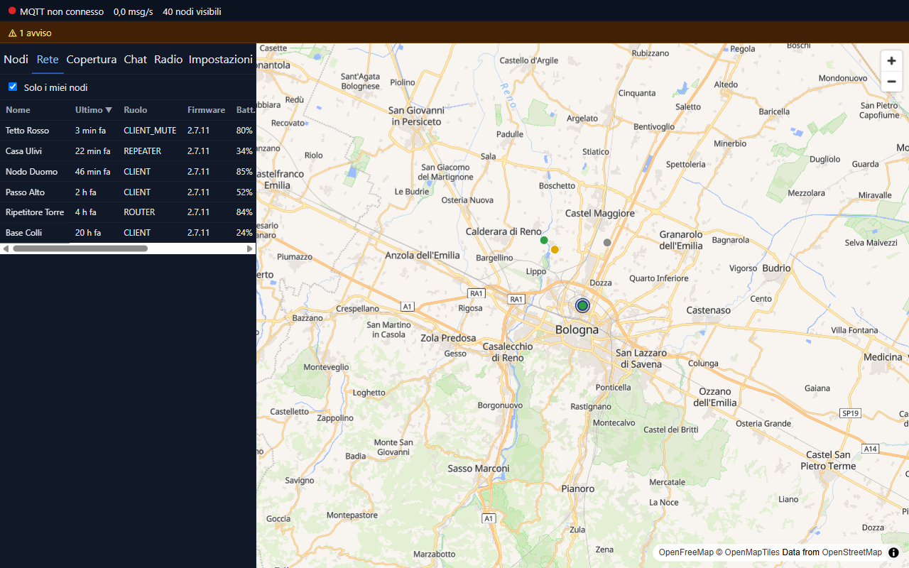
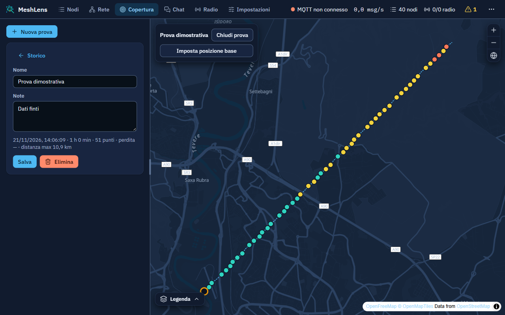
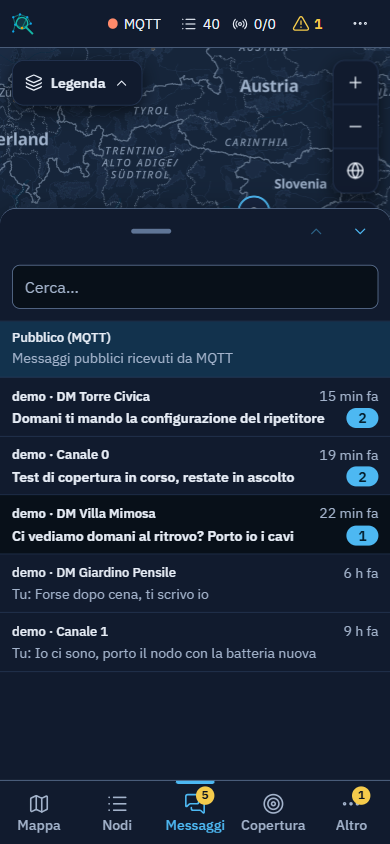

<p align="center"></p>

<p align="center">🇮🇹 <a href="README.md">Italiano</a></p>

<p align="center">
  
  
  
</p>

**MeshLens** is a local Windows application that brings everything happening on a [Meshtastic](https://meshtastic.org) network onto one interactive map: nodes heard over the **Internet (MQTT)** and by **your own radios** connected over USB or Bluetooth. Watch the network, manage your nodes and chat over radio, even without Internet. Use it from your PC and from your phone on the same Wi-Fi.

## Screenshots

| | |
|---|---|
| <br>**Map** with nodes from radio and MQTT | <br>**Node details** with battery chart |
| <br>**Network**: your nodes at a glance | <br>Field **coverage** tests |
| <br>**Offline maps** and updates | <br>**Phone** |

> Screenshots use a demo database with invented nodes. The app interface is in Italian.

## Features

### 🗺️ Map and observation
- MQTT and radio nodes merged in one view, colored by source and by last contact.
- Filters by country, source, radio, last contact, role and text.
- Node detail: hardware, role, firmware, position and precision, battery, SNR/RSSI/hops, position track.
- Public MQTT message feed, filterable by country.

### 📻 Radios and chat
- Several radios at once, over **USB** and **Bluetooth**, with automatic reconnection.
- Chat on channels and direct messages, with radio selection and delivery status.

### 📊 Network management
- Node status, **battery history charts** and alerts (configurable threshold, silent nodes).
- "My nodes": mark yours, and views and alerts focus on them.
- Link map colored by SNR and on-demand **traceroute**.

### 📡 Field coverage
- Coverage tests with the Range Test module: points colored by signal quality, route, missing points and session history.
- "Prepare radios" and "Restore" to set up and put back the configuration.

### ⚙️ Configuration
- Read and edit the configuration of connected radios and remote nodes (PKI admin keys).
- Every change goes through a **diff summary**, an **explicit confirmation** and a **restorable backup**.

### 🌍 Offline
- PMTiles maps via a guided download: low-detail world, Italy and areas of your choice.
- Automatic switch between online and offline maps.

## Requirements

- Windows 10 or 11.
- A Meshtastic radio with firmware **2.5 or newer** (tested with **2.7**) if you want to use radios. MQTT-only observation needs no radio.

## Installation

1. Download `MeshLens-Setup-X.Y.Z.exe` from the [Releases](https://github.com/iw8ffg/meshlens/releases) page (while the repository is private you must be signed in to a GitHub account with access).
2. Optionally verify the checksum against the attached `.sha256` file: `certutil -hashfile MeshLens-Setup-X.Y.Z.exe SHA256`.
3. Run the installer. It is **per user**: no administrator rights needed.
4. **SmartScreen:** the installer is not code-signed, so Windows may show "Windows protected your PC". Choose **More info → Run anyway**.

MeshLens starts with a notification-area icon (Open MeshLens, Open data folder, Start at sign-in, Exit). Uninstalling does not delete the data in `%LOCALAPPDATA%\MeshLens\data` unless you explicitly choose so.

## First start and PIN

On first start the browser opens `http://127.0.0.1:8686` and asks you to choose a **PIN**. Each device enters it once and is then remembered. If you forget it, close MeshLens (notification icon → Exit) and run `"%LOCALAPPDATA%\Programs\MeshLens\MeshLens.exe" reset-pin` from a Command Prompt: it prints nothing, and the next sign-in asks for a new PIN. From source (development) it stays `meshlens reset-pin`.

## Using it from your phone

1. In **Settings**, enable access from the local network (by default MeshLens only listens on the PC).
2. From the phone, on the same Wi-Fi, open `http://<PC-address>:8686` and enter the PIN.

Access is plain HTTP: use it only on a network you trust. No HTTPS also means no phone GPS and no browser push notifications.

## Offline maps

In **Settings → Offline maps** choose what to download (low-detail world, Italy, areas of your choice). It is a guided step and is not required to use the app. Without a connection MeshLens switches to the local maps by itself.

## Updates

MeshLens checks once a day for a new version (can be turned off). The downloaded file is verified with SHA-256: if it does not match it is deleted and nothing is installed. Installation only starts after your confirmation.

While the repository is **private** a token is required:

1. On GitHub: *Settings → Developer settings → Personal access tokens → Fine-grained tokens*.
2. Repository: `iw8ffg/meshlens`, permission **Contents: Read-only**.
3. The token must be created by the repository **owner**; collaborators should use a classic token with the `repo` scope.
4. In MeshLens: **Settings → Updates**, paste the token. It stays on your PC only and never appears in logs.

Once the repository is public the token is no longer needed.

## From source (development)

Requires Python 3.12–3.14, Node 24 and git.

```bat
git clone https://github.com/iw8ffg/meshlens.git
cd meshlens
start.bat
```

`start.bat` creates the Python environment, builds the interface and starts the server (data in `./data`). For development:

```bat
.venv\Scripts\python -m pytest
cd web && npm test && npm run dev
.venv\Scripts\python tools\demo_seed.py demo-data
.venv\Scripts\meshlens run --data-dir demo-data
```

The first command runs the server tests, the second the interface tests and a hot-reload dev server. The last two run MeshLens on a demo database with invented data.

## Privacy

- **No data is sent to anyone.** Everything stays in the database on your PC.
- MQTT is **listen-only**: MeshLens never publishes anything to public brokers.
- By default the server listens on `127.0.0.1` only; local-network access is your choice and is protected by the PIN.
- History expires (default: messages and positions 90 days, telemetry 1 year, configurable).
- The only outgoing connections are the ones you trigger: the MQTT broker, online maps, offline map downloads and the update check on GitHub.

## License

MeshLens is free software released under the **GNU GPL-3.0**. Copyright © 2026 iw8ffg. See [LICENSE](LICENSE) (official English text) and [LICENZA.md](LICENZA.md) (Italian summary). Bundled dependencies are listed in [THIRD_PARTY_NOTICES.md](THIRD_PARTY_NOTICES.md).

## Legal notes

MeshLens is an independent project and is **not affiliated with the Meshtastic project**. Meshtastic® is a registered trademark of Meshtastic LLC. MeshLens does not circumvent legal limits on radio use (duty cycle, power, presets): complying with them is the user's responsibility.

## Credits

- [Meshtastic](https://meshtastic.org) and its Python library.
- [Protomaps](https://protomaps.com) (PMTiles maps, style, glyphs and sprites) and go-pmtiles.
- [OpenStreetMap](https://www.openstreetmap.org/copyright) contributors (© OpenStreetMap contributors, ODbL).
- [OpenFreeMap](https://openfreemap.org) for the online map.
- [Natural Earth](https://www.naturalearthdata.com) for country borders.
