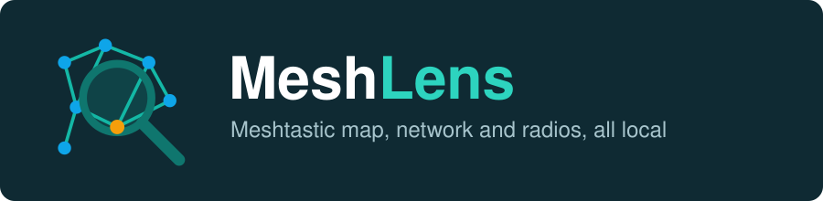
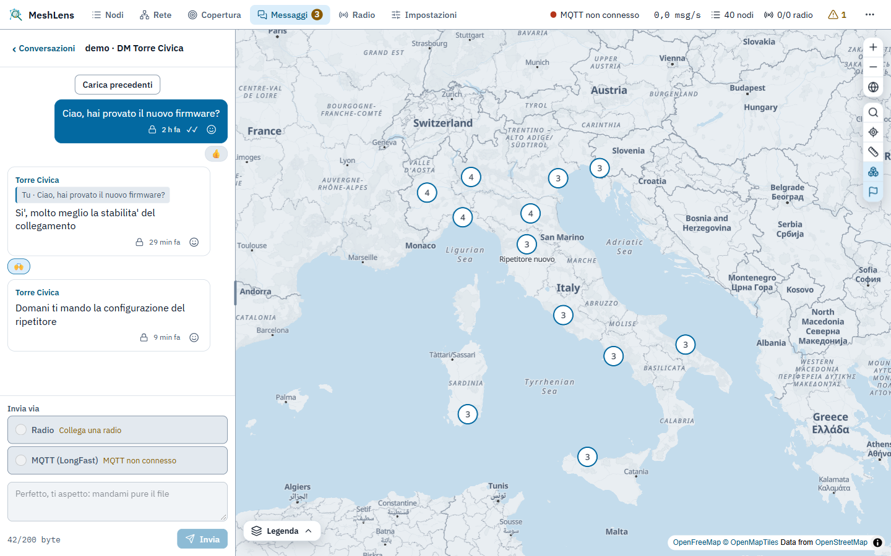
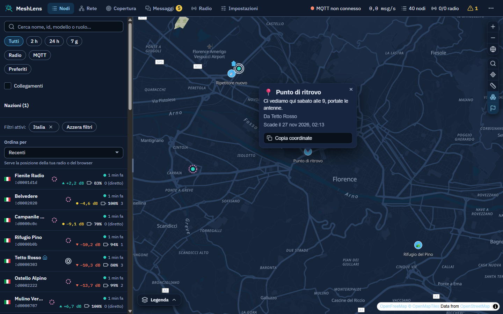
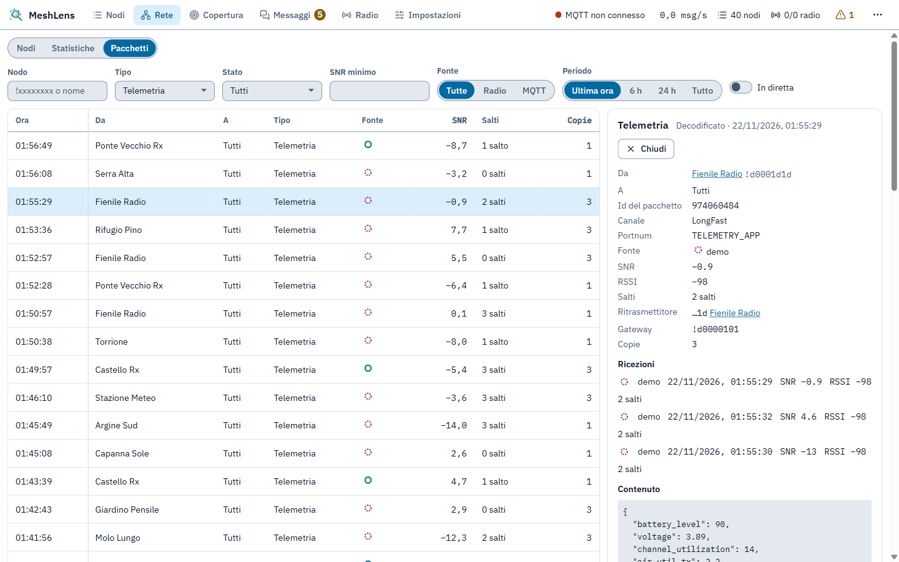
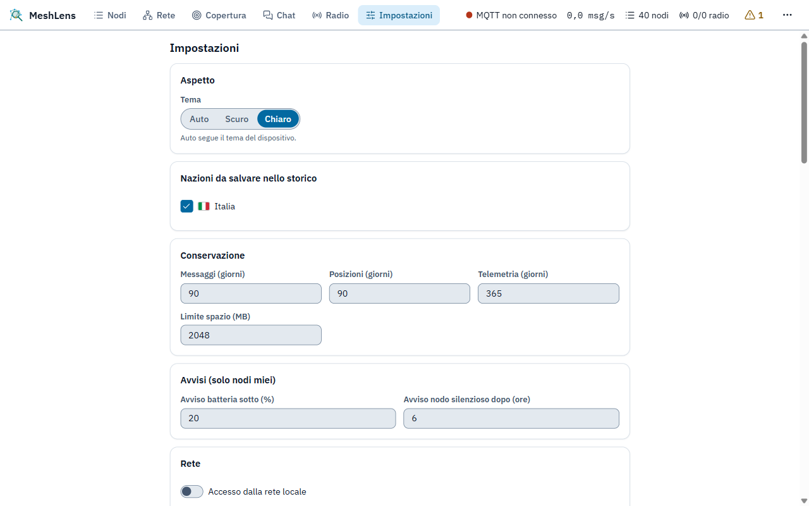
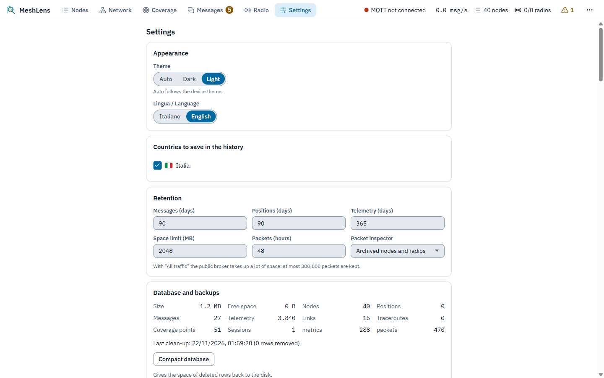

<p align="center"></p>

<p align="center">🇮🇹 <a href="README.md">Italiano</a></p>

<p align="center">
  
  
  
</p>

**MeshLens** is a local Windows application that brings everything happening on a [Meshtastic](https://meshtastic.org) network onto one interactive map: nodes heard over the **Internet (MQTT)** and by **your own radios** connected over USB or Bluetooth. Watch the network, manage your nodes and chat over radio, even without Internet. Use it from your PC and from your phone on the same Wi-Fi.

## Screenshots

| | |
|---|---|
| <br>**Map** | <br>**Network** |
| <br>**Chat** | <br>**Conversations** |
| <br>**Waypoints** | <br>**Predicted coverage** |
| <br>**Statistics** | <br>**Packets** |
| <br>**Node details** | <br>**Field coverage** |
| <br>**Settings** | <br>**Phone** |
| <br>**English interface** |  |

> Screenshots use a demo database with invented nodes, messages and positions. The interface is available in Italian and English.

## Features

### 🗺️ Map and observation
- MQTT and radio nodes merged in one view, colored by source and by last contact.
- Filters by country, source, radio, last contact, role and text; active filters stay visible as chips, with **"Clear filters"**.
- Node detail: hardware, role, firmware, position and precision, battery, SNR/RSSI/hops, position track with a **selectable period up to 90 days**; **direct link** to the node (`#/nodes/!id`).
- Map: distances and quick actions in popups, a **ruler**, optional node clustering, **node search**, **"Where am I"** and received **waypoints**.
- Node sorting and search by model and role too; your view is remembered.
- Public MQTT message feed, filterable by country, showing which broker each message came from.

### 📻 Radios and chat
- Several radios at once, over **USB** and **Bluetooth**, with automatic reconnection.
- Messages on channels and direct messages, with delivery status and a single **"Send via"** field: radio or **MQTT** (text only, as your own node, with a confirmation the first time), with a choice of **broker** and channel.
- **Dark and light** themes, designed for phones too.

### 💬 Messages
- **Conversation list** with preview, **search** and **drafts**; **unread** counters, `(n)` in the tab title and **browser notifications** for direct messages.
- **Replies and emoji reactions**, over radio and over MQTT.
- **Lock** on direct messages encrypted with the public key (PKI), a **warning when a node's key changes** and delivery error reasons in plain language.
- **Waypoints**: received ones appear on the map; you send your own over radio only.
- **External notifications**: Windows notifications from the notification-area icon and, if you enable it, a **Telegram bot** (token stored encrypted).
- **Recover missed messages** (Store & Forward): from the Radio tab, ask a router node for the history of messages you missed, without duplicates.

### 🌐 Several MQTT brokers and custom channels
- Connect **several MQTT brokers at once**, each with its own status and its own **Encryption** and **TLS** toggles (off for new brokers; the default broker keeps encryption).
- **Custom channels** per broker: added manually, imported from the connected radio or from a `meshtastic.org/e/#…` link. The key can only be shown from the PC.
- MQTT status explained (connection, messages per second, undecodable, last error) and **automatic reconnection**.

### 📊 Network management
- Node status, **battery history charts** and alerts: low battery, silent nodes, **channel saturated**, **node back online**, **old firmware**.
- "My nodes": mark yours, and views and alerts focus on them.
- Link map colored by SNR and on-demand **traceroute**.
- "Connection lost" bar and **Retry** buttons when something does not respond.

### 📈 Data and statistics
- **Telemetry** for environment, air quality, power and local node statistics, from MQTT and from radio.
- **Charts** with values shown as you hover and a **selectable period** (also channel use, SNR and sensors).
- **Exports** as **CSV** (with `;`, Excel-friendly), **GPX**, **GeoJSON** and **KML**.
- **Network statistics** and a **packet inspector** in the Network page, with retention settings to limit the space used.

### 📡 Field coverage
- Coverage tests with the Range Test module: points colored by signal quality, path, missing points and session history.
- "Prepare radios" and "Restore" to set up and put back the configuration.

### 📡 Predicted coverage
- **Coverage prediction** for a site (position, antenna height, power, gains) with the **NTIA ITM** model and **Terrarium** elevation data, downloaded only after you confirm.
- Result overlaid on the map and **compared with the measurements** from the Range Test; warning if the power exceeds the EU 868 legal limit.

### ⚙️ Configuration
- Read and edit the configuration of connected radios and remote nodes (PKI admin keys).
- Every change goes through a **diff summary**, an **explicit confirmation** and a **restorable safety copy**.

### 🌍 Offline and language
- PMTiles maps downloadable with a guided step: low-detail world, Italy and areas of your choice.
- Automatic switch between online and offline map.
- Interface available in **Italian** (default) and **English**: choose the language in Settings.

### 🔒 LAN access and HTTPS
- By default MeshLens listens on the PC only (`http://127.0.0.1:8686`). LAN access is enabled in Settings and protected by the PIN.
- With LAN access the PIN has at least **6 digits** (existing PINs keep working). After too many wrong attempts a lockout kicks in that survives restarts; the local PC is never locked out.
- In Settings you can see the connected **sessions and devices** and sign them out; you can also change the PIN.
- **Optional HTTPS** (off by default) on port **8687**, with a self-signed certificate generated by MeshLens: the browser will show a warning to accept the first time. `127.0.0.1:8686` stays plain HTTP.
- Tokens (GitHub for updates, Telegram bot) are stored encrypted with Windows DPAPI.

### 🧰 Backup and diagnostics
- **Automatic database backups**: before every update and migration and once a week (kept separately by type: the most recent copies of each kind). List and **restore** in Settings.
- **Export and import settings** (secrets are excluded unless requested from the PC).
- Downloadable **diagnostic bundle** (zip, without passwords or keys) and rotating logs.
- **Database maintenance:** chunked purge, statistics and a **"Compact database"** button.

## Requirements

- Windows 10 or 11.
- A Meshtastic radio with firmware **2.5 or newer** (tested with **2.7**) if you want to use radios. MQTT-only observation needs no radio.

## Installation

1. Download `MeshLens-Setup-X.Y.Z.exe` from the [Releases](https://github.com/iw8ffg/meshlens/releases) page (while the repository is private you must be signed in to a GitHub account with access).
2. Optionally verify the checksum against the attached `.sha256` file: `certutil -hashfile MeshLens-Setup-X.Y.Z.exe SHA256`.
3. Run the installer. It is **per user**: no administrator rights needed.
4. **SmartScreen:** the installer is not code-signed, so Windows may show "Windows protected your PC". Choose **More info → Run anyway**.

MeshLens starts with a notification-area icon (Open MeshLens, Open data folder, Start at sign-in, Exit). Uninstalling does not delete the data in `%LOCALAPPDATA%\MeshLens\data` unless you explicitly choose so.

## First start and PIN

On first start the browser opens `http://127.0.0.1:8686` and asks you to choose a **PIN**. Each device enters it once and is then remembered. If you forget it, close MeshLens (notification icon → Exit) and run `"%LOCALAPPDATA%\Programs\MeshLens\MeshLens.exe" reset-pin` from a Command Prompt: it prints nothing, and the next sign-in asks for a new PIN. From source (development) it stays `meshlens reset-pin`.

## Using it from your phone

1. In **Settings**, enable access from the local network (by default MeshLens only listens on the PC).
2. From the phone, on the same Wi-Fi, open `http://<PC-address>:8686` and enter the PIN.

By default access is plain HTTP: use it only on a network you trust. Without HTTPS there is no phone GPS; browser notifications for direct messages work if you allow the page to send them, but on phones they generally need HTTPS. For access from the local network you can enable optional HTTPS in **Settings → Network** (port 8687, with a self-signed certificate generated by MeshLens: the browser will ask you to accept it).

## Offline maps

In **Settings → Offline maps** choose what to download (low-detail world, Italy, areas of your choice). It is a guided step and is not required to use the app. Without a connection MeshLens switches to the local maps by itself.

## Updates

MeshLens checks once a day for a new version (can be turned off). The downloaded file is verified with SHA-256: if it does not match it is deleted and nothing is installed. Installation only starts after your confirmation.

While the repository is **private** a token is required:

1. On GitHub: *Settings → Developer settings → Personal access tokens → Fine-grained tokens*.
2. Repository: `iw8ffg/meshlens`, permission **Contents: Read-only**.
3. The token must be created by the repository **owner**; collaborators should use a classic token with the `repo` scope.
4. In MeshLens: **Settings → Updates**, paste the token. It stays on your PC only and never appears in logs.

Once the repository is public the token is no longer needed.

## From source (development)

Requires Python 3.12–3.14, Node 24 and git.

```bat
git clone https://github.com/iw8ffg/meshlens.git
cd meshlens
start.bat
```

`start.bat` creates the Python environment, builds the interface and starts the server (data in `./data`). For development:

```bat
.venv\Scripts\python -m pytest
cd web && npm test && npm run dev
.venv\Scripts\python tools\demo_seed.py demo-data
.venv\Scripts\meshlens run --data-dir demo-data
```

The first command runs the server tests, the second the interface tests and a hot-reload dev server. The last two run MeshLens on a demo database with invented data.

## Privacy

- **No data is sent to anyone.** Everything stays in the database on your PC.
- On MQTT MeshLens **listens** and publishes **only the text messages you send** with "Send via MQTT" (as your own node, with a confirmation the first time and a rate limit). Nothing else is ever published: no positions, no node data.
- By default the server listens on `127.0.0.1` only; local-network access is your choice and is protected by the PIN.
- History expires (default: messages and positions 90 days, telemetry 1 year, configurable).
- The only outgoing connections are the ones you trigger: the MQTT broker, online maps, offline map downloads and the update check on GitHub; on request, the download of elevation data (Terrarium, open data on AWS) for predicted coverage; and, only if you enable it, Telegram notifications.

## License

MeshLens is free software released under the **GNU GPL-3.0**. Copyright © 2026 iw8ffg. See [LICENSE](LICENSE) (official English text) and [LICENZA.md](LICENZA.md) (Italian summary). Bundled dependencies are listed in [THIRD_PARTY_NOTICES.md](THIRD_PARTY_NOTICES.md).

## Legal notes

MeshLens is an independent project and is **not affiliated with the Meshtastic project**. Meshtastic® is a registered trademark of Meshtastic LLC. MeshLens does not circumvent legal limits on radio use (duty cycle, power, presets): complying with them is the user's responsibility.

## Credits

- [Meshtastic](https://meshtastic.org) and its Python library.
- [Protomaps](https://protomaps.com) (PMTiles maps, style, glyphs and sprites) and go-pmtiles.
- [OpenStreetMap](https://www.openstreetmap.org/copyright) contributors (© OpenStreetMap contributors, ODbL).
- [OpenFreeMap](https://openfreemap.org) for the online map.
- [Natural Earth](https://www.naturalearthdata.com) for country borders.
