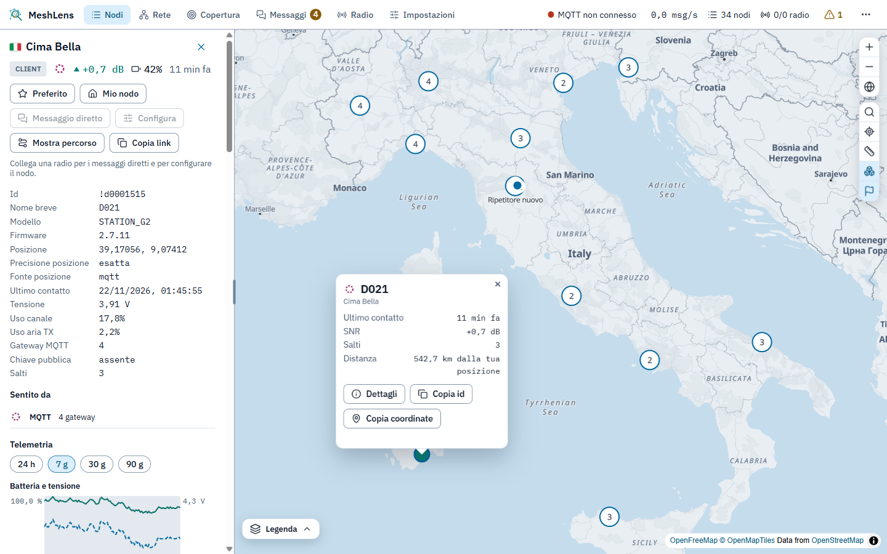
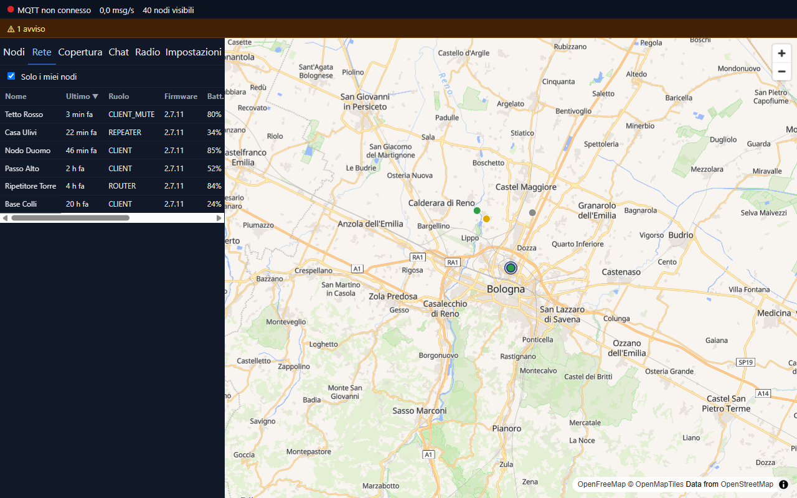
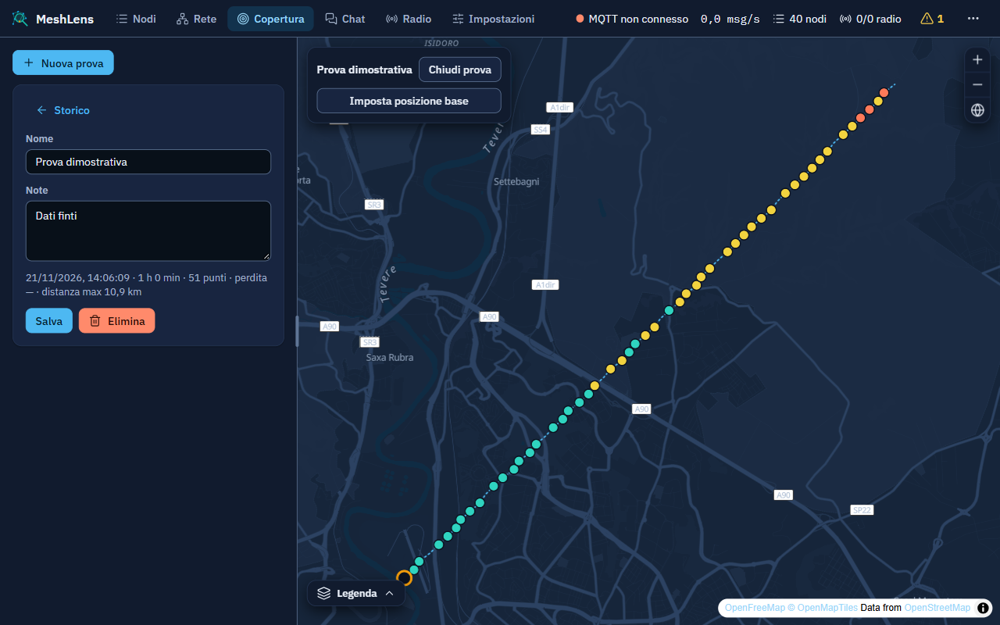
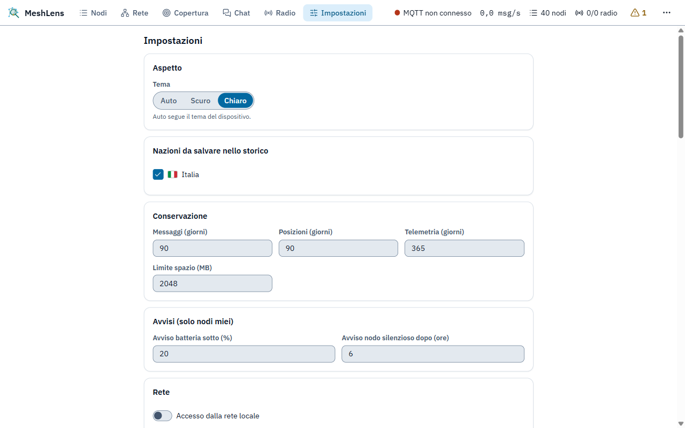
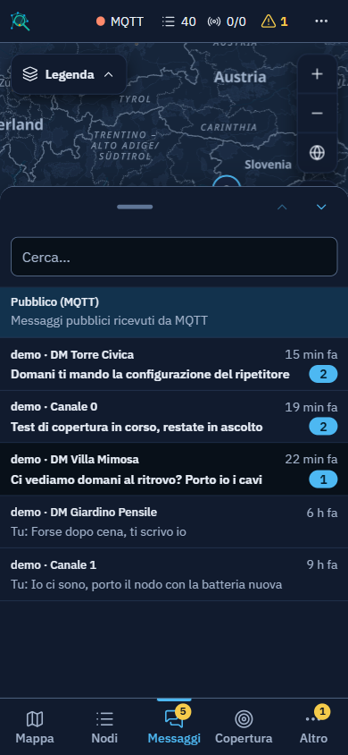

<p align="center"></p>

<p align="center">🇬🇧 <a href="README.en.md">English</a></p>

<p align="center">
  
  
  
</p>

**MeshLens** è un'applicazione locale per Windows che riunisce in un'unica mappa interattiva tutto ciò che accade su una rete [Meshtastic](https://meshtastic.org): i nodi sentiti da **Internet (MQTT)** e dalle **tue radio** collegate via USB o Bluetooth. Osservi la rete, gestisci i tuoi nodi e chatti via radio, anche senza Internet. Si usa dal PC e dal telefono sulla stessa Wi-Fi.

## Schermate

| | |
|---|---|
| <br>**Mappa** con i nodi da radio e MQTT | <br>**Dettaglio nodo** con grafico della batteria |
| <br>**Rete**: i tuoi nodi a colpo d'occhio | <br>**Copertura** sul campo |
| <br>**Mappe offline** e aggiornamenti | <br>**Telefono** |

> Le schermate usano un database dimostrativo con nodi inventati.

## Funzioni principali

### 🗺️ Mappa e osservazione
- Nodi da MQTT e da radio fusi in un'unica vista, con colore per fonte e per ultimo contatto.
- Filtri per nazione, fonte, radio, ultimo contatto, ruolo e testo; i filtri attivi restano visibili come chip, con **"Azzera filtri"**.
- Dettaglio nodo: hardware, ruolo, firmware, posizione e precisione, batteria, SNR/RSSI/hop, traccia dei percorsi; **link diretto** al nodo (`#/nodes/!id`).
- Mappa: distanze e azioni rapide nei popup, **righello**, raggruppamento dei nodi attivabile, **ricerca di un nodo** e **"Dove sono"**.
- Ordinamento dei nodi e ricerca anche per modello e ruolo; la vista viene ricordata.
- Feed dei messaggi pubblici MQTT, filtrabile per nazione, con l'indicazione del broker di provenienza.

### 📻 Radio e chat
- Più radio insieme, via **USB** e **Bluetooth**, con riconnessione automatica.
- Messaggi su canali e diretti, con stato di consegna e un unico campo **"Invia via"**: radio oppure **MQTT** (solo testo, a nome del tuo nodo, con conferma la prima volta), con scelta del **broker** e del canale.
- Interfaccia con tema **scuro e chiaro**, pensata anche per il telefono.

### 🌐 Più broker MQTT e canali personalizzati
- Collega **più broker MQTT insieme**, ognuno con il proprio stato e i propri interruttori **Crittografia** e **TLS** (spenti per i broker nuovi; il broker predefinito mantiene la crittografia).
- **Canali personalizzati** per broker: aggiunti a mano, importati dalla radio collegata o da un link `meshtastic.org/e/#…`. La chiave si può mostrare solo dal PC.
- Stato MQTT spiegato (connessione, messaggi al secondo, non decodificabili, ultimo errore) e **ricollegamento automatico**.

### 📊 Gestione della rete
- Stato dei nodi, **batteria con grafico storico** e avvisi: batteria bassa, nodi silenziosi, **canale saturo**, **nodo tornato online**, **firmware vecchio**.
- "I miei nodi": marca i tuoi, viste e avvisi si concentrano su di loro.
- Mappa dei collegamenti colorata per SNR e **traceroute** a richiesta.
- Barra "connessione persa" e pulsanti **Riprova** quando qualcosa non risponde.

### 📡 Copertura sul campo
- Prove di copertura con il modulo Range Test: punti colorati per qualità del segnale, percorso, punti mancanti e storico delle sessioni.
- "Prepara le radio" e "Ripristina" per impostare e rimettere a posto la configurazione.

### ⚙️ Configurazione
- Lettura e modifica della configurazione delle radio collegate e dei nodi remoti (chiavi admin PKI).
- Ogni modifica passa da un **riepilogo delle differenze**, una **conferma esplicita** e una **copia di sicurezza ripristinabile**.

### 🌍 Offline
- Mappe PMTiles scaricabili con un passo guidato: mondo a basso dettaglio, Italia e aree a scelta.
- Passaggio automatico tra mappa online e offline.

### 🔒 Accesso dalla rete locale e HTTPS
- Di default MeshLens ascolta solo sul PC (`http://127.0.0.1:8686`). L'accesso dalla rete locale si attiva in Impostazioni ed è protetto dal PIN.
- Con l'accesso dalla rete locale il PIN ha almeno **6 cifre** (i PIN già impostati continuano a funzionare). Dopo troppi errori scatta un blocco che resiste al riavvio; il PC locale non resta mai chiuso fuori.
- In Impostazioni vedi **sessioni e dispositivi** collegati e puoi disconnetterli; puoi anche cambiare il PIN.
- **HTTPS facoltativo** (spento di default) sulla porta **8687**, con certificato autofirmato generato da MeshLens: la prima volta il browser mostrerà un avviso da accettare. Su `127.0.0.1:8686` resta HTTP.
- Il token GitHub per gli aggiornamenti è salvato cifrato con Windows DPAPI.

### 🧰 Backup e diagnostica
- **Backup automatici** del database: prima di ogni aggiornamento e migrazione e una volta a settimana (ne restano 5). Elenco e **ripristino** da Impostazioni.
- **Esporta e importa le impostazioni** (i segreti restano esclusi salvo richiesta dal PC).
- **Pacchetto diagnostico** scaricabile (zip, senza password né chiavi) e log con rotazione.
- **Manutenzione del database:** pulizia a blocchi, statistiche e pulsante **"Compatta database"**.

## Requisiti

- Windows 10 o 11.
- Una radio Meshtastic con firmware **2.5 o superiore** (provato con il **2.7**), se vuoi usare le radio. Per la sola osservazione MQTT non serve alcuna radio.

## Installazione

1. Scarica `MeshLens-Setup-X.Y.Z.exe` dalla pagina [Releases](https://github.com/iw8ffg/meshlens/releases) (finché il repository è privato serve l'accesso con il tuo account GitHub).
2. Controlla l'impronta con il file `.sha256` allegato (facoltativo ma consigliato): `certutil -hashfile MeshLens-Setup-X.Y.Z.exe SHA256`.
3. Avvia l'installer. È **per utente**: non servono i permessi di amministratore.
4. **SmartScreen:** l'installer non è firmato, quindi Windows può mostrare "Windows ha protetto il PC". Scegli **Ulteriori informazioni → Esegui comunque**.

MeshLens parte con un'icona nell'area di notifica (Apri MeshLens, Apri cartella dati, Avvia all'accesso, Esci). Disinstallando, i dati in `%LOCALAPPDATA%\MeshLens\data` non vengono cancellati, salvo una tua scelta esplicita.

## Primo avvio e PIN

Al primo avvio il browser si apre su `http://127.0.0.1:8686` e ti chiede di scegliere un **PIN**. Ogni dispositivo lo inserisce una volta e poi resta riconosciuto. Se lo dimentichi, chiudi MeshLens (icona di notifica → Esci) e dal Prompt dei comandi esegui `"%LOCALAPPDATA%\Programs\MeshLens\MeshLens.exe" reset-pin`: non stampa nulla e al prossimo accesso ti chiede un nuovo PIN. Da sorgente (sviluppo) resta `meshlens reset-pin`.

## Uso dal telefono

1. In **Impostazioni** attiva l'accesso dalla rete locale (di default MeshLens ascolta solo sul PC).
2. Dal telefono, collegato alla stessa Wi-Fi, apri `http://<indirizzo-del-PC>:8686` e inserisci il PIN.

L'accesso avviene di default in HTTP semplice: usalo solo su una rete di cui ti fidi. Senza HTTPS non sono disponibili il GPS del telefono né le notifiche push del browser. Per l'accesso dalla rete locale puoi attivare HTTPS facoltativo in **Impostazioni → Rete** (porta 8687, con certificato autofirmato generato da MeshLens: il browser chiederà di accettarlo).

## Mappe offline

In **Impostazioni → Mappe offline** scegli cosa scaricare (mondo a basso dettaglio, Italia, aree a scelta). Lo scaricamento è un passo guidato e non è obbligatorio per usare l'app. Senza connessione MeshLens passa da solo alle mappe locali.

## Aggiornamenti

MeshLens controlla da solo una volta al giorno se c'è una nuova versione (si può disattivare). Il file scaricato viene verificato con SHA-256: se non coincide viene cancellato e nulla viene installato. L'installazione parte solo dopo la tua conferma.

Finché il repository è **privato** serve un token:

1. Su GitHub: *Settings → Developer settings → Personal access tokens → Fine-grained tokens*.
2. Repository: `iw8ffg/meshlens`, permesso **Contents: Read-only**.
3. Il token deve essere creato dal **proprietario** del repository; se sei un collaboratore usa un token classico con permesso `repo`.
4. In MeshLens: **Impostazioni → Aggiornamenti**, incolla il token. Resta solo sul tuo PC e non compare mai nei log.

Quando il repository sarà pubblico il token non servirà più.

## Da sorgente (sviluppo)

Servono Python 3.12–3.14, Node 24 e git.

```bat
git clone https://github.com/iw8ffg/meshlens.git
cd meshlens
start.bat
```

`start.bat` crea l'ambiente Python, compila l'interfaccia e avvia il server (dati in `./data`). Per lo sviluppo:

```bat
.venv\Scripts\python -m pytest
cd web && npm test && npm run dev
.venv\Scripts\python tools\demo_seed.py demo-data
.venv\Scripts\meshlens run --data-dir demo-data
```

Il primo comando esegue i test del server, il secondo quelli dell'interfaccia e la avvia con ricarica a caldo. Gli ultimi due avviano MeshLens su un database dimostrativo con dati inventati.

## Privacy

- **Nessun dato viene inviato a nessuno.** Tutto resta nel database sul tuo PC.
- Su MQTT MeshLens **ascolta** e pubblica **solo i messaggi di testo che invii tu** scegliendo "Invia via MQTT" (a nome del tuo nodo, con conferma la prima volta e un limite di frequenza). Nient'altro viene mai pubblicato: né posizioni né dati dei nodi.
- Per default il server ascolta solo su `127.0.0.1`; l'accesso dalla rete locale è una tua scelta ed è protetto dal PIN.
- Lo storico ha una scadenza configurabile (default: messaggi e posizioni 90 giorni, telemetria 1 anno).
- Le uniche connessioni in uscita sono quelle che avvii tu: il broker MQTT, le mappe online, lo scaricamento delle mappe offline e il controllo degli aggiornamenti su GitHub.

## Licenza

MeshLens è software libero, rilasciato con licenza **GNU GPL-3.0**. Copyright © 2026 iw8ffg. Vedi [LICENSE](LICENSE) (testo ufficiale in inglese) e [LICENZA.md](LICENZA.md) (riassunto in italiano). Le dipendenze incluse sono elencate in [THIRD_PARTY_NOTICES.md](THIRD_PARTY_NOTICES.md).

## Note legali

MeshLens è un progetto indipendente e **non è affiliato al progetto Meshtastic**. Meshtastic® è un marchio registrato di Meshtastic LLC. MeshLens non aggira i limiti di legge sull'uso delle frequenze (duty cycle, potenza, preset): rispettarli resta responsabilità dell'utente.

## Ringraziamenti

- [Meshtastic](https://meshtastic.org) e la sua libreria Python.
- [Protomaps](https://protomaps.com) (mappe PMTiles, stile, glifi e sprite) e go-pmtiles.
- I contributori di [OpenStreetMap](https://www.openstreetmap.org/copyright) (© OpenStreetMap contributors, ODbL).
- [OpenFreeMap](https://openfreemap.org) per la mappa online.
- [Natural Earth](https://www.naturalearthdata.com) per i confini delle nazioni.
